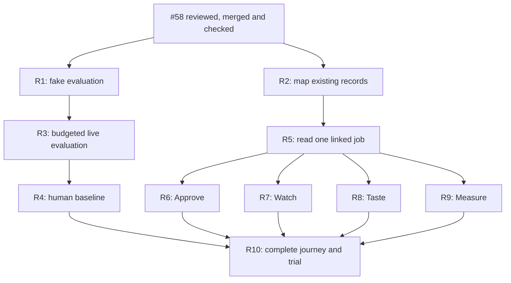

# First complete release

The operator chose this release boundary: **think → shape → approve → watch →
taste → measure**. The north star is **useful, verified changes per operator
hour**, from [the constitution](../yohaku.md). A useful result meets the original
goal, passes its required checks and is accepted by the operator.

The operator requested this plan and its [ten tasks](first-release-issues.md).
R1 ([#62](https://github.com/jon-devlapaz/tinkery/issues/62)) and R2
([#63](https://github.com/jon-devlapaz/tinkery/issues/63)) are done. R3–R10 remain
unpublished drafts. No private data use, provider budget or merge is authorized.

## Starting point

Checked on October 12, 2026 against main at `4f520b2`, including #58:

| Place | Available now | Needed for this release |
| --- | --- | --- |
| Think | Refine a dump and explicitly save its confirmed goal | Repeatable quality checks and operator recognition on permitted examples |
| Shape | List saved goals and copy a continuation prompt | Trace the same goal through the existing external workflow |
| Approve | Placeholder | Show the exact pending decision and a deliberate approval handoff |
| Watch | Placeholder | Show trustworthy progress and the next action for one job |
| Taste | Placeholder | Compare a result and its checks with the original goal |
| Measure | Display a separately installed ledger report, or unknown | Report accepted results and recorded human effort honestly |

[#58](https://github.com/jon-devlapaz/tinkery/issues/58) is finished:
[PR #59](https://github.com/jon-devlapaz/tinkery/pull/59) is merged and
[main CI at `4f520b2`](https://github.com/jon-devlapaz/tinkery/actions/runs/38344917007)
passed. Recheck the current main revision when starting approved implementation.

Sources: [current scope](../../README.md), [menu](menu.md),
[handoff](shape-and-handoff.md), [Think records](think.md#think-record).

## Finish line

- [ ] A real change travels through all six places without the operator having to
  reconstruct or re-explain the goal at a handoff.
- [ ] Original words and the confirmed goal survive exactly. Goal confirmation,
  seed confirmation, intake approval and implementation permission stay distinct.
- [ ] The operator can tell what is happening, what needs a decision and what to
  do next. Missing, failed or outdated evidence never appears as success.
- [ ] Taste shows checks for the exact result being reviewed. The operator accepts
  the result or requests correction, and retains the merge decision.
- [ ] An interrupted journey can return to the same work with a clear next step.
- [ ] A small repeatability trial shows less active operator effort on comparable
  work, without losing correctness or required decisions. The operator judges
  whether the improvement is useful. No improvement is claimed without evidence.

Propose three comparable changes for the trial; the operator chooses the sample
and success threshold before live work. This is a practical release check, not a
statistical claim about all work. Establish the comparison baseline before using
the new full-loop views on the trial tasks.

Keep the existing manual agent handoff for this release. An integrated launcher,
automatic approval or merge, multi-run dashboard and the Think convenience
proposals are outside this release unless real use reveals a specific blocker.
The [existing backlog](backlog.md) remains available; it is not the release checklist.

## Milestones and dependencies

Draft IDs below are local labels, not GitHub issue numbers. Completion of a draft
means its checks pass and its change is reviewed and merged where code is involved.

| Milestone | Completion evidence | Draft issues |
| --- | --- | --- |
| M1. Trust the goal | #58 finished; safe evaluation; exact handoff; operator recognition and attention baseline recorded separately | [R1](first-release-issues.md#r1), [R3](first-release-issues.md#r3), [R4](first-release-issues.md#r4) |
| M2. Connect the handoffs | One goal can be traced to its seed, decisions, run, checks and result, including missing or outdated records | [R2](first-release-issues.md#r2), [R5](first-release-issues.md#r5) |
| M3. Approve | The displayed revision and required decision agree with the existing approval mechanism | [R6](first-release-issues.md#r6) |
| M4. Watch | One external job has a reliable state, source freshness and next action | [R7](first-release-issues.md#r7) |
| M5. Taste | The operator can judge the exact result against the goal and supporting checks | [R8](first-release-issues.md#r8) |
| M6. Prove saved attention | All six places work together and a permitted trial demonstrates useful improvement | [R9](first-release-issues.md#r9), [R10](first-release-issues.md#r10) |

M1 and M2 can progress alongside each other. A real-data budget does not block
the zero-call source survey or record readers. Approve, Watch and Taste can be
built separately after R5 settles their shared input. The complete journey must
wait for every branch; milestone numbering is not a reason to serialize them all.

## What agents can start next

R1 and R2 are done. The other tasks remain drafts; finishing one does not
authorize the next.

An agent can implement and fake-test R3 without spending a live budget. R5 waits
for the operator to accept R2's [proposed design](job-records.md); then an agent
can build it while live evaluation awaits the operator. R4 needs supplied
examples, explicit permission to use them, an approved provider/model budget and
human participation. Only the operator can
say that the goal is right or that the result is useful.

Measure's field survey belongs in R2. R9 can proceed once the reader and measurement
definitions are ready; the completed human baseline is required for R10's comparison,
not for implementing the report. If the existing report already meets R9's checks,
record that evidence and make no code change.

Keep one writer in Think's overlapping controller, prompts and tests. Once R5 is
merged, use separate approved branches for R6/R7/R8. One integrator owns shared
menu, command-line and architecture-check changes; other phase writers do not
edit those files concurrently. Do not create agents simply to keep them busy.

## How to measure the benefit

Record active human time for explaining, deciding, reviewing and correcting.
Include repeated explanations and rework. Record waiting separately. A Think
record's start/end times describe elapsed time, not active attention.

Use accepted, checked changes divided by recorded active operator hours as the
main measure. Show the underlying counts and minutes. Missing time, zero time or
an unknown acceptance verdict means the rate is unknown. Show task differences
and per-task observations so a tiny sample cannot hide a costly failure.

Distinguish fake runs, real-provider runs and operator judgments explicitly.
`origin: live` alone is insufficient: a stub can run through the live host. Report
actual spend only when recorded; label estimates and unknowns. Reuse existing
records and the ledger where they support these meanings. R2 must identify gaps;
this plan does not assert that upstream tools already provide every field.

At each completed slice, compare evidence with the intended behavior. Continue
when it holds, repair a demonstrated problem in a bounded follow-up, or revise
the remaining draft if new evidence changes the approach. Do not expand the
release with speculative cleanup.
