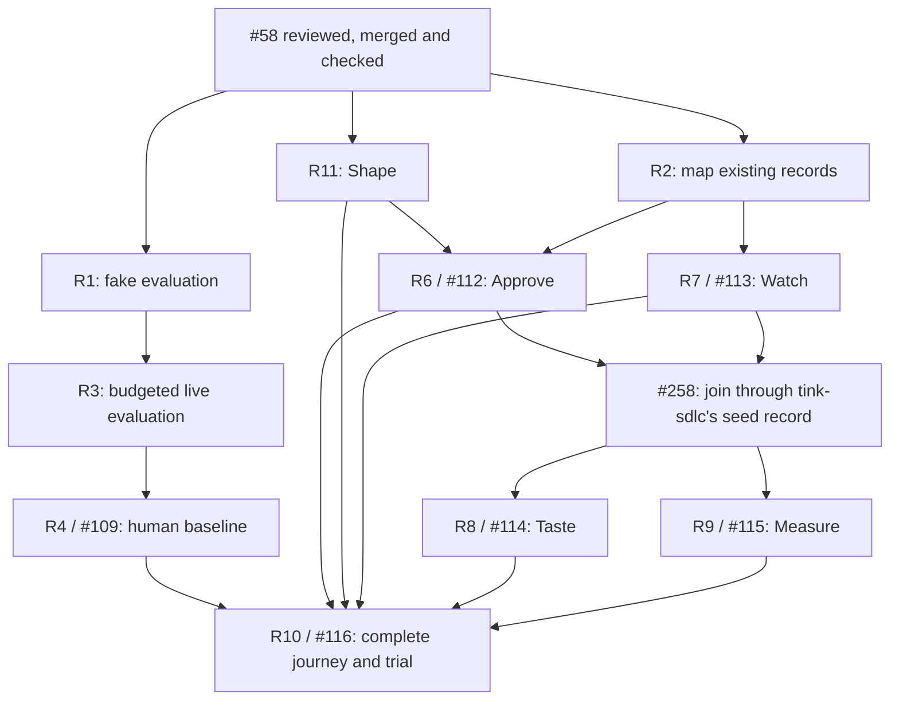

# First complete release

The journey is **Think → Tend → Shape → Approve → Watch → Taste → Measure**.
The [constitution](../yohaku.md) defines success as **useful, verified changes per
operator hour**: the result meets the goal, passes checks and earns operator acceptance.

The [task index](first-release-issues.md)
links the authoritative issues for scope, status, approval and completion evidence.
On 2026-10-19 the operator dropped the Tinkery binding (#110, #111): [#258](https://github.com/jon-devlapaz/tinkery/issues/258)
joins Approve and Watch through tink-sdlc's own seed record instead. R2's revised design is not accepted and no longer needed. Publication
approves no build, private data use, provider budget or merge.

## Starting point

Read [current scope](../../README.md), [menu](menu.md), [handoff](shape-and-handoff.md)
and [Think records](think.md#think-record), then recheck current main before
approved implementation.

## Finish line

- [ ] One real change crosses all seven places without reconstructing or re-explaining intent.
- [ ] Original words and the confirmed goal survive exactly. Goal, seed, intake and
  implementation decisions remain separate.
- [ ] The state, required decision and next step are clear. Missing, failed or outdated
  evidence never means success.
- [ ] Taste checks the exact result. The operator accepts it or requests correction
  and retains the merge decision.
- [ ] Interrupted work resumes as the same work with a clear next step.
- [ ] A permitted trial on comparable work shows less active effort without losing
  correctness or required decisions. The operator judges usefulness; claim no
  unmeasured improvement.

Propose three comparable changes. The operator selects the sample and success
threshold before live work; establish the baseline before full-loop views.
This trial is not a statistical claim about all work.

An explicit key starts each seed agent step in Shape. Implementation retains
the manual handoff. Integrated launching, automatic approval or merge, multi-run
dashboards and Think conveniences are excluded absent a demonstrated blocker.
Measure currently reads no source and shows work and attention as unknown.
Results and effort await separately approved [#155](https://github.com/jon-devlapaz/tinkery/issues/155)
and [#115](https://github.com/jon-devlapaz/tinkery/issues/115).
[Run retention and lessons](../research/shared/backlog.md#keep-runs-and-learn-from-them)
are separate drafts, not R5 prerequisites.
The [backlog](../research/shared/backlog.md) is not the release checklist.

## Milestones and dependencies

R and I labels link to issues. Milestones give neither permission nor deadlines.
Code completion requires issue evidence, review and merge.

| Milestone | Evidence | Tasks |
| --- | --- | --- |
| M1. Trust the goal | Evaluation is safe, handoffs are exact, and human recognition and the baseline are recorded separately. | [R1](first-release-issues.md#r1), [R3](first-release-issues.md#r3), [R4](first-release-issues.md#r4) |
| M2. Connect | tink-sdlc's seed record joins each seed to its run. Missing and outdated evidence stay distinct. | [R2](first-release-issues.md#r2), [#258](https://github.com/jon-devlapaz/tinkery/issues/258) |
| M3. Approve | The displayed revision agrees with the decision mechanism. | [R6](first-release-issues.md#r6) |
| M4. Watch | One job has a reliable state, freshness and next action. | [R7](first-release-issues.md#r7) |
| M5. Taste | The operator judges the exact result against the goal and checks. | [R8](first-release-issues.md#r8) |
| M7. Shape | A confirmed goal becomes a confirmed seed; Tinkery owns the session and ledger. | [R11](first-release-issues.md#r11) |
| M6. Save attention | The complete permitted journey and trial demonstrate improvement. | [R9](first-release-issues.md#r9), [R10](first-release-issues.md#r10) |

M1 and M2 may overlap. A real-data budget doesn't block zero-call surveys or readers.
Approve and Watch proceed separately; #258 then joins them, and Taste and Measure wait on that join.
The journey waits for every branch, not milestone order.

## What agents can start next

Choose an explicitly approved [task](first-release-issues.md). Finishing one or
its dependencies does not authorize the next.

#112 and #113 are approved. #258 needs approval and waits on them and
[tink-sdlc#68](https://github.com/jon-devlapaz/tink-sdlc/issues/68). These slices
need no model calls. R4 separately
requires supplied examples, data permission, a provider and model budget, and human
participation. Only the operator judges meaning and usefulness.

R2 surveys measurement fields. R9 needs the reader and measurement definitions,
not the completed human baseline; R10 needs that baseline. If the existing report
meets R9, record the evidence without changing code.

One writer owns Think's overlapping controller, prompts and tests. Separate
approved branches may own R6/R7/R8. One integrator owns shared menu,
CLI and architecture changes; phase writers must not edit them concurrently.
Don't spawn agents to fill time.

## How to measure the benefit

Record active time spent explaining, deciding, reviewing and correcting, including
repeated explanations and rework. Record waiting separately. Think's elapsed
timestamps are not active attention.

Divide accepted, checked changes by recorded active operator hours. Show the counts
and minutes. Missing or zero time, or unknown acceptance, makes the rate unknown.
Disclose task differences and individual observations so tiny samples cannot hide
costly failures.

Distinguish fakes, real providers and human judgments: `origin: live` can be stubbed.
Actual spend requires records; label estimates and unknowns. Reuse existing records
and the ledger where their meanings fit. R2 identifies gaps, never presumes upstream fields.

After each slice, compare behavior with evidence. Continue, repair demonstrated
problems in bounded follow-ups, or revise the remaining drafts. Do not expand the
release with speculative cleanup.
