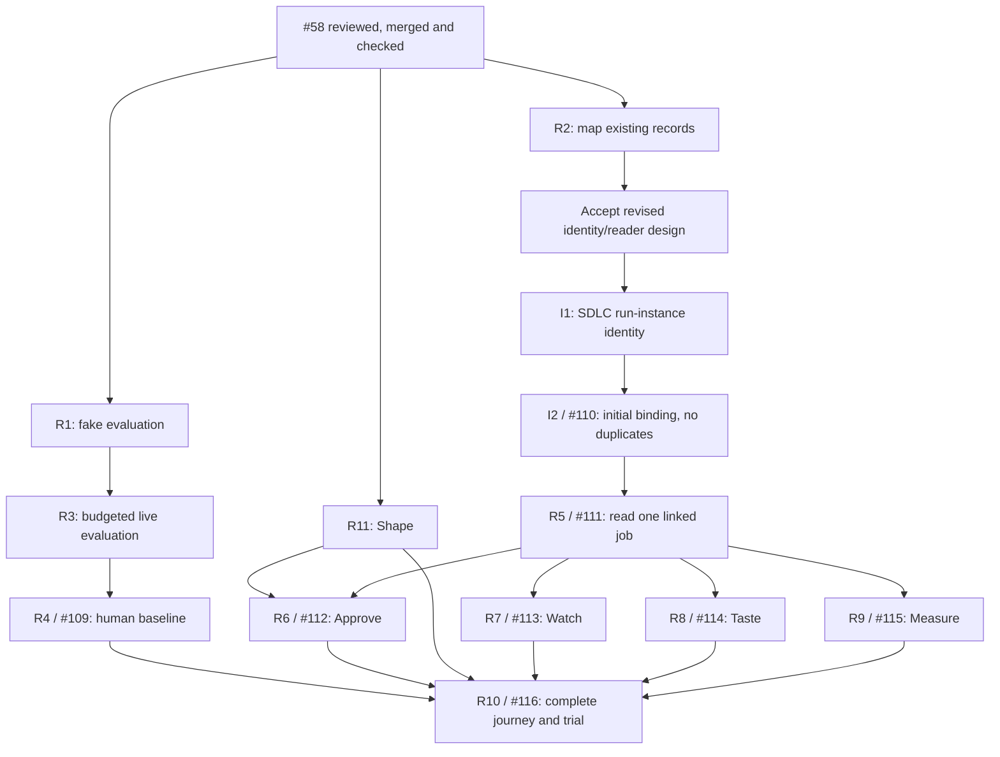

# First complete release

The release boundary is **think → tend → shape → approve → watch → taste → measure**
(tend replaced the operator's original shape list on 2026-10-14,
[#123](https://github.com/jon-devlapaz/tinkery/issues/123); the operator put shape, the
Seed Me step, back in this release on 2026-10-15). The north star is **useful, verified changes per operator hour**,
from [the constitution](../yohaku.md). A useful result meets the original goal,
passes its required checks and is accepted by the operator.

The operator requested this plan. The [task index](first-release-issues.md)
links the authoritative issues for scope, status, approval and completion evidence.
R2's revised design is not accepted; publication approves no prerequisite/reader
build, private data use, provider budget or merge.

## Starting point

Baseline checked on October 12, 2026 against main at `4f520b2`, including #58;
the tend row reflects the replacement above:

| Place | Available now | Needed for this release |
| --- | --- | --- |
| Think | Refine a dump and explicitly save its confirmed goal | Repeatable quality checks and operator recognition on permitted examples |
| Tend | Show saved goals in a read-only garden, open detail and copy a continuation prompt | Trace the same goal through the existing external workflow |
| Shape | Copy a continuation prompt; the interview runs outside Tinkery | Run Seed Me's interview on a confirmed goal and end with a seed the operator confirms |
| Approve | Placeholder | Show the exact pending decision and a deliberate approval handoff |
| Watch | Placeholder | Show trustworthy progress and the next action for one job |
| Taste | Placeholder | Compare a result and its checks with the original goal |
| Measure | Display a separately installed ledger report, or unknown | Report accepted results and recorded human effort honestly |

[#58](https://github.com/jon-devlapaz/tinkery/issues/58) is finished:
[PR #59](https://github.com/jon-devlapaz/tinkery/pull/59) is merged and
[main CI at `4f520b2`](https://github.com/jon-devlapaz/tinkery/actions/runs/38344917007)
passed. Recheck the current main revision when starting approved implementation.

Sources: [current scope](../../README.md), [menu](menu.md),
[handoff](shape-and-handoff.md), [Think records](think.md#think-record).

## Finish line

- [ ] A real change travels through all seven places without the operator having to
  reconstruct or re-explain the goal at a handoff.
- [ ] Original words and the confirmed goal survive exactly. Goal confirmation,
  seed confirmation, intake approval and implementation permission stay distinct.
- [ ] The operator can tell what is happening, what needs a decision and what to
  do next. Missing, failed or outdated evidence never appears as success.
- [ ] Taste shows checks for the exact result being reviewed. The operator accepts
  the result or requests correction, and retains the merge decision.
- [ ] An interrupted journey can return to the same work with a clear next step.
- [ ] A small repeatability trial shows less active operator effort on comparable
  work, without losing correctness or required decisions. The operator judges
  whether the improvement is useful. No improvement is claimed without evidence.

Propose three comparable changes for the trial; the operator chooses the sample
and success threshold before live work. This is a practical release check, not a
statistical claim about all work. Establish the comparison baseline before using
the new full-loop views on the trial tasks.

Shape runs the Seed Me step inside Tinkery, each agent step started by an explicit
operator key. Keep the existing manual handoff for implementation. An integrated launcher,
automatic approval or merge, multi-run dashboard and the Think convenience
proposals are outside this release unless real use reveals a specific blocker.
The [Substrate absorption decision](../research/shared/backlog.md#absorb-substrate-keep-runs-and-learn-from-them)
makes Tinkery the shared-reader owner, not a permanent client of Substrate's
aggregation service. Run retention and reviewed lessons remain separate drafts;
R5 does not wait for them. The [parked backlog](../research/shared/backlog.md)
holds unpublished proposals, not the release checklist.

## Milestones and dependencies

R/I IDs below remain local labels; the task index links their authoritative
GitHub issues. Milestones group work, not permission or deadlines. Completion
requires issue evidence and review/merge where code is involved.

| Milestone | Completion evidence | Task references |
| --- | --- | --- |
| M1. Trust the goal | #58 finished; safe evaluation; exact handoff; operator recognition and attention baseline recorded separately | [R1](first-release-issues.md#r1), [R3](first-release-issues.md#r3), [R4](first-release-issues.md#r4) |
| M2. Connect the handoffs | Explicit goal-to-run binding and Tinkery-owned reading trace the seed, decisions, run, checks and result; missing/outdated evidence stays distinct | [R2](first-release-issues.md#r2), [I1/I2](first-release-issues.md#r5-identity), [R5](first-release-issues.md#r5) |
| M3. Approve | The displayed revision and required decision agree with the existing approval mechanism | [R6](first-release-issues.md#r6) |
| M4. Watch | One external job has a reliable state, source freshness and next action | [R7](first-release-issues.md#r7) |
| M5. Taste | The operator can judge the exact result against the goal and supporting checks | [R8](first-release-issues.md#r8) |
| M7. Shape | A confirmed goal becomes a confirmed seed inside Tinkery, with Seed Me's session as the only record | [R11](first-release-issues.md#r11) |
| M6. Prove saved attention | All seven places work together and a permitted trial demonstrates useful improvement | [R9](first-release-issues.md#r9), [R10](first-release-issues.md#r10) |

M1 and M2 can progress alongside each other. A real-data budget does not block
the zero-call source survey or record readers. Approve, Watch and Taste can be
built separately after R5 settles their shared input. The complete journey must
wait for every branch; milestone numbering is not a reason to serialize them all.

## What agents can start next

Select an explicitly approved task from the [task index](first-release-issues.md).
Finishing one or satisfying its dependencies does not authorize the next.

Before R5, review R2's [revised design](job-records.md), refresh the source
contracts, and separately approve missing I1/I2 capabilities. Verify source-owned
run identity and initial local binding creation with duplicate detection;
existing capabilities need evidence, not replacement. Binding revisions and
relocation are deferred. The narrowed binding design remains unaccepted;
[I2 and R5](first-release-issues.md#r5-identity) need separate implementation
approval afterward.
An unlinked source read is not completion of R5. These slices need no model calls;
R4 separately needs supplied examples, data permission, provider/model budget and
human participation. Only the operator can judge goal meaning and usefulness.

Measure's field survey belongs in R2. R9 can proceed once the reader and measurement
definitions are ready; the completed human baseline is required for R10's comparison,
not for implementing the report. If the existing report already meets R9's checks,
record that evidence and make no code change.

Keep one writer in Think's overlapping controller, prompts and tests. Once R5 is
merged, use separate approved branches for R6/R7/R8. One integrator owns shared
menu, command-line and architecture-check changes; other phase writers do not
edit those files concurrently. Do not create agents simply to keep them busy.

## How to measure the benefit

Record active human time for explaining, deciding, reviewing and correcting.
Include repeated explanations and rework. Record waiting separately. A Think
record's start/end times describe elapsed time, not active attention.

Use accepted, checked changes divided by recorded active operator hours as the
main measure. Show the underlying counts and minutes. Missing time, zero time or
an unknown acceptance verdict means the rate is unknown. Show task differences
and per-task observations so a tiny sample cannot hide a costly failure.

Distinguish fake runs, real-provider runs and operator judgments explicitly.
`origin: live` alone is insufficient: a stub can run through the live host. Report
actual spend only when recorded; label estimates and unknowns. Reuse existing
records and the ledger where they support these meanings. R2 must identify gaps;
this plan does not assert that upstream tools already provide every field.

At each completed slice, compare evidence with the intended behavior. Continue
when it holds, repair a demonstrated problem in a bounded follow-up, or revise
the remaining draft if new evidence changes the approach. Do not expand the
release with speculative cleanup.
