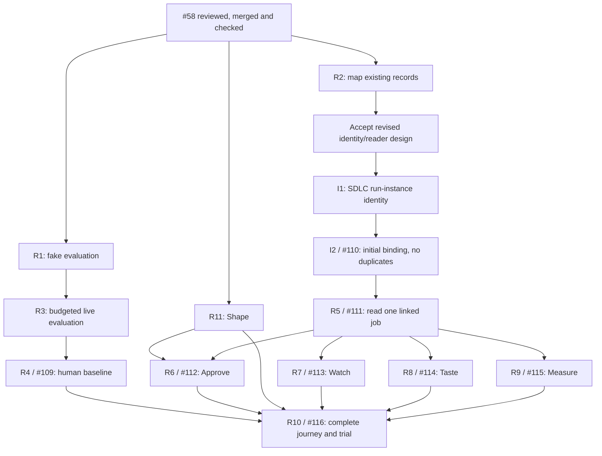

# First complete release

**Think → Tend → Shape → Approve → Watch → Taste → Measure.** Success is
**useful, verified changes per operator hour**: original goal met, checks passed,
operator accepted ([constitution](../yohaku.md)).

The [task index](first-release-issues.md)
links the authoritative issues for scope, status, approval and completion evidence.
R2's revised design is not accepted; publication approves no prerequisite/reader
build, private data use, provider budget or merge.

## Starting point

Read [current scope](../../README.md), [menu](menu.md), [handoff](shape-and-handoff.md)
and [Think records](think.md#think-record), then recheck current main before
approved implementation. Issues hold completion evidence; this page defines the
release, not a dated inventory.

## Finish line

- [ ] One real change crosses all seven places without reconstructing/re-explaining intent.
- [ ] Original words/confirmed goal survive exactly; goal, seed, intake and implementation
  decisions remain separate.
- [ ] State, required decision and next step are clear; missing/failed/outdated evidence
  never means success.
- [ ] Taste checks the exact result; operator accepts/corrects and retains merge decision.
- [ ] Interrupted work resumes as the same work with a clear next step.
- [ ] Permitted comparable-work trial shows less active effort without losing correctness
  or required decisions. Operator judges usefulness; claim no unmeasured improvement.

Propose three comparable changes; operator selects sample/threshold before live
work. Establish baseline before full-loop trial views. This practical check is
not a statistical claim about all work.

Shape starts each Seed Me agent step on an explicit key; implementation retains
manual handoff. Integrated launching, automatic approval/merge, multi-run dashboards
and Think conveniences are excluded absent a demonstrated blocker.
[Substrate absorption](../research/shared/backlog.md#absorb-substrate-keep-runs-and-learn-from-them)
makes Tinkery reader owner, not permanent aggregation client. Retention/lessons
are separate drafts, not R5 prerequisites. [Backlog](../research/shared/backlog.md)
is not the release checklist.

## Milestones and dependencies

R/I labels link to issues. Milestones give neither permission nor deadlines;
completion needs issue evidence and review/merge for code.

| Milestone | Evidence | Tasks |
| --- | --- | --- |
| M1. Trust goal | Safe eval, exact handoff, separately recorded human recognition/baseline | [R1](first-release-issues.md#r1), [R3](first-release-issues.md#r3), [R4](first-release-issues.md#r4) |
| M2. Connect | Binding/owned reader trace seed, decisions, run, checks/result; distinguish missing/outdated | [R2](first-release-issues.md#r2), [I1/I2](first-release-issues.md#r5-identity), [R5](first-release-issues.md#r5) |
| M3. Approve | Displayed revision agrees with decision mechanism | [R6](first-release-issues.md#r6) |
| M4. Watch | One job's state, freshness, next action | [R7](first-release-issues.md#r7) |
| M5. Taste | Exact result judged against goal/checks | [R8](first-release-issues.md#r8) |
| M7. Shape | Confirmed goal → confirmed seed; Seed Me alone owns session | [R11](first-release-issues.md#r11) |
| M6. Save attention | Complete permitted journey/trial demonstrates improvement | [R9](first-release-issues.md#r9), [R10](first-release-issues.md#r10) |

M1/M2 may overlap; real-data budget doesn't block zero-call survey/readers.
Approve/Watch/Taste can proceed separately after shared R5 inputs. Full journey
waits for every branch, not milestone numerical order.

## What agents can start next

Choose an explicitly approved [task](first-release-issues.md); finishing one or
its dependencies does not authorize the next.

Before R5: accept [R2 design](job-records.md), refresh contracts, verify source-owned
run identity/initial binding/duplicates, separately approve missing I1/I2. Existing
capabilities need evidence, not replacement; revisions/relocation stay deferred.
[I2/R5](first-release-issues.md#r5-identity) need separate implementation approval.
Unlinked reads don't complete R5. No model calls needed; R4 separately requires
supplied examples, data permission, provider/model budget and human participation.
Only operator judges meaning/usefulness.

R2 surveys measurement fields; R9 needs reader/definitions, not completed human
baseline (R10 does). If existing report meets R9, record evidence without code.

One writer owns overlapping Think controller/prompts/tests. After merged R5,
separate approved branches may own R6/R7/R8. One integrator owns shared menu/CLI/
architecture changes, never concurrent phase writers. Don't spawn agents to fill time.

## How to measure the benefit

Record active explaining, deciding, reviewing, correcting, repeated explanations
and rework; waiting separately. Think elapsed timestamps are not active attention.

Rate = accepted checked changes / recorded active operator hours; show counts/
minutes. Missing/zero time or unknown acceptance makes rate unknown. Disclose task
differences/per-task observations so tiny samples cannot hide costly failures.

Distinguish fakes, real providers and human judgments: `origin: live` can be stubbed.
Actual spend requires records; label estimates/unknowns. Reuse existing records/
ledger where meanings fit; R2 identifies gaps, never presumes upstream fields.

After each slice compare behavior/evidence: continue, repair demonstrated problems
in bounded follow-ups, or revise remaining drafts. No speculative release cleanup.
